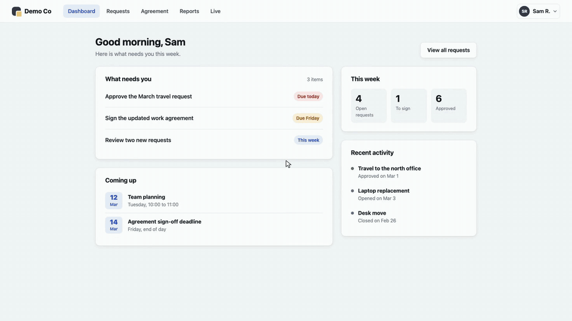

# scenecast

scenecast turns a short scene file into a narrated walkthrough video of your real web app. It records the app in
Chromium, voices your script with a local text-to-speech model, makes every click and keystroke land on the word that
names it, and adds zoom, highlight rings, captions, title cards and music. Then it audits the finished video moment
by moment, and fails the render if any moment is off.

It is free and open source, runs on your own machine, and needs no accounts or API keys.



*Part of the demo video, rendered from [`examples/demo-app/video.yaml`](examples/demo-app/video.yaml). The GIF has
no sound; the video is narrated.*

## What makes it different

- **Actions land on their words.** Each step names a cue word from the narration. scenecast reads the word timings
  from the voice and drives the browser so the cursor arrives and the click happens on that word. Pages that load
  slowly are absorbed by holding or trimming frames, so the action stays on its word.
- **Scene files you can re-record.** The video is described in YAML: narration, selectors, seed data and sign-in. When
  the app changes, render again. There is no timeline to edit by hand.
- **An audit of every moment.** After the render, scenecast transcribes the final video with Whisper and checks every
  cued step: was the action within 0.30 s of its word, does the ring or zoom contain the element, does any caption
  cover the target, the cursor or an open panel, is the zoom cropped, was a spinner or a blank page showing, is the
  loudness right. The result is a table, a contact sheet and an exit code. The included demo passes every cued moment,
  with a median gap of about 0.01 s between word and action and a largest gap of 0.030 s, over five cold renders.
- **Captions that know the UI.** Captions move out of the way of whatever is being clicked, typed into or highlighted
  (to the top, a corner, or beside the phone on phone scenes), including while the view is zoomed in. They break at
  the narration's clauses, and the voice pauses briefly there too.
- **Made for real apps.** Feature flags and slow third parties can be answered with routes, init scripts run before
  the app does, sign-ins kept in sessionStorage are saved and restored, zooms end on a cue word, the cursor parks out
  of the way, phone scenes use touch, and the intro and outro cards take a gradient or image background, their own
  font, an entrance and a "next" line (or an HTML page of your own).
- **Local and free.** Voice by [Kokoro](https://huggingface.co/hexgrad/Kokoro-82M), speech recognition by
  [faster-whisper](https://github.com/SYSTRAN/faster-whisper), recording by [Playwright](https://playwright.dev),
  composition by [Revideo](https://re.video/). Every dependency is under an open-source licence: see
  [THIRD_PARTY.md](THIRD_PARTY.md).

## Requirements

- macOS or Linux (WSL works; Windows itself does not).
- Node.js 24 and pnpm 10.
- About 2 GB of disk space for the models, the Python environment and Chromium.

`scenecast doctor` sets up everything else without admin rights (and `scenecast render` does the same on first use
if you skip doctor). It writes:

- [uv](https://github.com/astral-sh/uv), via its official installer, to `~/.local/bin/uv` (or
  `~/.cache/scenecast/bin/uv` when that folder is not writable), with its Python in `~/.local/share/uv/python` and its
  package cache in `~/.cache/uv`;
- the Python environment in `py/.venv` inside the checkout (it includes ffmpeg);
- the Kokoro and Whisper models and NLTK data, about 1 GB, in `~/.cache/scenecast/`.

On Linux, Chromium may need system libraries: `pnpm -C packages/cli exec playwright install --with-deps chromium`
installs them (this one step asks for admin rights).

## Quickstart

```sh
# in a clone of this repository
pnpm install
pnpm -C packages/cli exec playwright install chromium
node packages/cli/bin/scenecast.js doctor

# start the demo app (an invented product, included in the repo), then render its video
node examples/demo-app/server.mjs &
node packages/cli/bin/scenecast.js render examples/demo-app/video.yaml
```

The video is written to `out/demo.mp4`, with `out/demo.srt`, `out/chapters.txt` and the audit in `out/audit/`. Open
`out/audit/audit-table.md` to see every moment checked.

To make your own video, copy `examples/demo-app/video.yaml`, point `app.baseUrl` at your app, and write your
narration and steps. The scene format is documented in
[`skill/references/scene-format.md`](skill/references/scene-format.md).

```yaml
- id: sign-in
  kind: app
  route: /login
  signedOut: true
  narration: >-
    To sign in, type your work email, then your password, and press Sign in.
  steps:
    - { cue: email, do: type, sel: "#email", text: sam@example.com }
    - { cue: password, do: type, sel: "#password", text: demo-password }
    - { cue: Sign in, occ: 2, do: click, sel: "#signin" }
```

## Commands

```
scenecast doctor                      check the toolchain (uv, Python, ffmpeg, Chromium, models)
scenecast login <video.yaml>          sign in by hand and save app.storageState
scenecast render <video.yaml> [--only <sceneId>] [--no-audit] [--keep-work] [--fresh]
                              [--out <dir>] [--work <dir>]
scenecast preview <video.yaml>        open the composed video in the Revideo player
```

`render` exits with 0 when the audit passes and 1 when any moment FAILs, so it can gate a CI job. Stages whose inputs
did not change are reused from `work/<id>/`; `--fresh` redoes them all, for example after the app itself changed.
A render locks `work/<id>/` while it runs, so a second render of the same video into the same folder stops at once,
naming the folder and the pid of the render that holds it (use `--work <dir>` to run both).

## How long it takes

Recording happens in real time, so a render takes several times the length of the video:

- composing the video (zoom, rings, captions, cards): about 2× the video length;
- a whole first render: about 3.5 to 7× the video length, because recording, the voice and speech recognition add
  to it. The 46-second demo takes about 3 minutes on a 12-core Linux PC; an Apple silicon Mac is slower (the 44-second v1
  demo took 4 to 5 minutes);
- a re-run with nothing changed: under a second, as every stage comes from the cache.

## Use it from Claude Code

[`skill/`](skill/) is a Claude Code skill. It walks Claude through writing the script and the scene file, rendering,
reading every row of the audit, and fixing what fails. Copy the folder to `~/.claude/skills/scenecast/` (or your
project's `.claude/skills/`) to use it.

## Development

```sh
pnpm test                                      # unit tests (TypeScript)
<uv> run --project py pytest                   # Python tests; <uv> is the path doctor prints on its uv line
node scripts/check-licences.mjs                # every dependency's licence is allowed and listed
SCENECAST_E2E=1 pnpm -C packages/cli exec vitest run -t e2e   # the whole demo render (slow)
```

The repository is a pnpm workspace: `packages/core` (scene format, voice, scheduling, recording, captions, mix,
audit), `packages/compose` (the Revideo composer), `packages/cli`, and `py/` (the Python side: voice, music, audit).

## Licence

MIT. See [LICENSE](LICENSE). Third-party licences, models and tools are listed in [THIRD_PARTY.md](THIRD_PARTY.md).
